# AnswerWise AI

**Automated Descriptive Answer Evaluation with Explainable Feedback**
NLP Practical CEC - subject 221601906, Natural Language Processing (NLP) Practicals

AnswerWise AI is a web application that helps teachers evaluate descriptive (written) answers. A teacher writes a question, a reference answer and a **rubric** of key concepts with marks. When students submit, an NLP engine checks each answer concept by concept. It suggests marks, quotes the sentences that earned them, lists what is missing and writes feedback. The teacher reviews this, adjusts marks where needed and publishes. Students then see their marks with an explanation.

> AI marks are **suggestions**. The teacher always has the final decision, and the app keeps the AI score and the teacher's final score side by side.

> **Evaluation status (engine 4.1.0, final quality audit).** Every accuracy figure in this README comes from **synthetic answers written and marked by one person, the engine developer**. Both held-out sets have now been used, so neither is a fresh test any more. Real-world grading reliability **has not been established**, and the system is **not validated for high-stakes grading**. See [docs/QUALITY_AUDIT_v4.md](docs/QUALITY_AUDIT_v4.md) for the audit, [docs/PILOT_READINESS.md](docs/PILOT_READINESS.md) for classroom pilot readiness, and [docs/REAL_STUDENT_EVALUATION_PROTOCOL.md](docs/REAL_STUDENT_EVALUATION_PROTOCOL.md) for the prepared (not yet run) real-student study.

---

## Contents

1. [Problem statement](#1-problem-statement)
2. [Objectives](#2-objectives)
3. [Main features](#3-main-features)
4. [Teacher and student workflows](#4-teacher-and-student-workflows)
5. [Architecture](#5-architecture)
6. [NLP methodology](#6-nlp-methodology)
7. [Scoring algorithm](#7-scoring-algorithm)
8. [Dataset and evaluation methodology](#8-dataset-and-evaluation-methodology)
9. [Technology stack](#9-technology-stack)
10. [Folder structure](#10-folder-structure)
11. [Environment setup](#11-environment-setup)
12. [Installation and running](#12-installation-and-running)
13. [Seed data](#13-seed-data)
14. [API documentation](#14-api-documentation)
15. [Data model](#15-data-model)
16. [Tests and results](#16-tests-and-results)
17. [Limitations and future scope](#17-limitations-and-future-scope)
18. [Screenshots](#18-screenshots)
19. [References](#19-references)
20. [License](#20-license)

---

## 1. Problem statement

Marking descriptive answers by hand takes a long time, and students can express the same idea in very different words. Teachers need a tool that:

- compares answers with a reference answer and a marking rubric,
- recognises relevant concepts even when the wording differs,
- points out missing key points,
- suggests marks, and
- explains *why*, so that both teachers and students can trust and learn from the result.

## 2. Objectives

- Build a rubric-aware, **explainable** NLP scoring pipeline rather than a word-overlap counter.
- Keep the teacher in control: AI suggestion → teacher review → publication.
- Give students specific, evidence-based feedback.
- Measure the engine honestly against human reference marks, compare it with baselines and report its weaknesses.
- Deliver a secure, usable two-role web application (teacher and student only).

## 3. Main features

**Teacher**
- Register / log in; dashboard showing work that needs attention.
- Create assessments (title, subject, instructions, optional deadline, all students or selected students).
- Question and rubric editor: question text, maximum marks, reference answer, concepts with marks and optional keywords, performance-level descriptions and optional per-question thresholds. Marks are validated live.
- **Rubric sandbox**: try a sample answer against the saved rubric before publishing.
- Publish / close / reopen assessments.
- Submissions list with status, AI total, final total and review flags; batch "evaluate all pending" and "publish all evaluated".
- Review page for each answer:
  - AI-suggested score vs final score;
  - evidence highlighted inside the student's original text;
  - concept-by-concept breakdown with the reason for each decision;
  - review flags, generated feedback, and the reference answer on demand;
  - score adjustment (a reason is required when the AI score is changed; every review is kept in an append-only log);
  - optional pilot safeguard `REQUIRE_REVIEW_BEFORE_PUBLISH`: results cannot be published until every question has been reviewed;
  - evaluation history.
- Re-evaluation after a rubric change. The rubric version is tracked, outdated evaluations are flagged, and publication is blocked until they are re-evaluated.
- Analytics: class average, median and range, score distribution, average per question, coverage of each rubric concept, and statistics on teacher adjustments.
- Profile and password change.

**Student**
- Register / log in; dashboard with to-do items, awaiting results, published results and a progress chart.
- Assessment list with clear status: Pending, Draft saved, Submitted, Evaluated, Result published, Missed.
- Answer editor with word counts, draft autosave and manual save, deadline display, and a submit confirmation that warns about unanswered questions.
- Submission history.
- Published results: final marks (`earned / maximum`), the answer with highlighted evidence, matched / partial / missing concepts, improvement suggestions and the teacher's comment. A note appears when the teacher adjusted the AI suggestion.
- Progress over time and the concepts missed most often.

**Security**
- bcrypt password hashing; JWT bearer tokens. The role is **re-read from the database on every request**, never taken from the token or the request body.
- Every lookup is scoped to the owner. Other people's records return 404, so the API does not reveal that they exist.
- Students never receive reference answers, rubric keywords, thresholds or internal similarity numbers. They receive results only after publication.
- Optional teacher invite code. Secrets live in `.env`; `.env.example` contains placeholders only. Consistent error responses; logs never include request bodies.

## 4. Teacher and student workflows

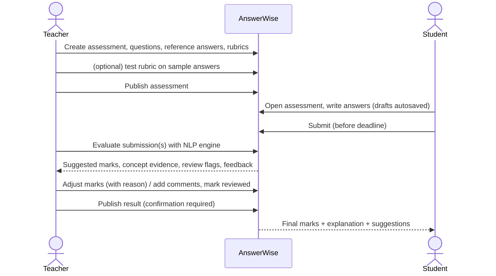

Submission states: `draft → submitted → evaluated → published` (a published result can be unpublished for correction).

## 5. Architecture

```
┌──────────────────────────────┐      HTTPS / JSON       ┌───────────────────────────────────────────────┐
│  React + Vite + TypeScript   │ ──────────────────────▶ │ FastAPI  (backend/app)                        │
│  Tailwind, Radix (shadcn-    │  Authorization: Bearer  │  routers/   auth, assessments, questions,     │
│  style), React Query,        │ ◀────────────────────── │             submissions, evaluations,         │
│  Recharts                    │                          │             results, analytics                │
│  (frontend/)                 │                          │  services/  ownership checks, evaluation      │
└──────────────────────────────┘                          │             versioning, publication, review   │
                                                          │  nlp/       ── independent of web & DB ──     │
                                                          │   preprocessing → similarity → scorer         │
                                                          │   → feedback; rubric validation; metrics      │
                                                          └───────────────┬────────────────┬──────────────┘
                                                                          │                │
                                                                   ┌──────▼─────┐   ┌──────▼─────────────────┐
                                                                   │  MongoDB   │   │ all-MiniLM-L6-v2       │
                                                                   │            │   │ (sentence-transformers)│
                                                                   └────────────┘   │ fallback: TF-IDF       │
                                                                                    └────────────────────────┘
```

The NLP package (`backend/app/nlp`) has no FastAPI or MongoDB imports. The API, the unit tests and the offline evaluation scripts all use exactly the same code.

## 6. NLP methodology

| Stage | What it does | Where |
|---|---|---|
| **Normalisation** | Unicode NFC (not NFKC, so `x²` stays `x²`), typographic quotes and dashes mapped to ASCII, whitespace collapsed. Mathematical symbols and punctuation are kept. | `nlp/preprocessing.py` |
| **Sentence segmentation** | Done on the *original* text, returning character offsets. Handles bullet lists and line breaks, and does not split on `e.g.`, `i.e.` or decimals. Long sentences are also split into clauses, because one sentence often contains several concepts. | `segment_sentences`, `split_clauses` |
| **Tokenisation** | Words, numbers and symbols (`+ = ^` are kept). | `tokenize` |
| **Stop words** | Used **only** for keyword evidence, never removed from the text given to the embedding model. Negations (`not`, `no`, `without`) are never stop words. | `STOP_WORDS`, `content_words` |
| **Spelling tolerance** | Misspelt words are mapped to the question's own vocabulary (same first letter, character similarity ≥ 0.84, length ≥ 5), e.g. `tokenizaton → tokenization`. Each correction is recorded and shown to the teacher. | `correct_spelling` |
| **Abbreviations** | `NER` becomes `NER (named entity recognition)`: the long form is appended and nothing is removed. Expansion is skipped when the long form is already written nearby. | `expand_abbreviations` |
| **Concept normalisation** | Porter stems of content words; used to merge duplicate rubric items and for fuzzy key-term matching. | `normalize_concept`, `term_coverage` |
| **Semantic similarity** | `sentence-transformers/all-MiniLM-L6-v2` embeddings with cosine similarity. | `nlp/similarity.py` |
| **Topic-debiased similarity** | The question's own embedding direction is projected out of both texts before the cosine is computed. Otherwise *every* on-topic sentence looks similar to *every* concept, because they all mention the topic word. See §7 for the effect. | `EmbeddingBackend.similarity(remove=...)` |
| **Correctness safeguards (v3)** | Rule-based checks derived from the question and rubric: swapped definitions (entity-masked content vs named entity), reversed comparisons, added negations. Affected concepts are not credited or are downgraded, and the answer is flagged for review. See §7, step 7. | `nlp/correctness.py` |
| **v4 additions** | Keyword-list detector requires the absence of *predicate cues* (bug fix); **echo guard**: a sentence that only names or restates the question's topic is not evidence; **antonym check**: evidence that swaps a concept word for its antonym (minimise/maximise, low/high) is downgraded and flagged. | `preprocessing.py`, `correctness.py` |
| **v4.1 additions (audit)** | **Attribute-swap check**: in a concept that contrasts two things ("common → low, distinctive → high"), evidence that attaches each property to the other side is downgraded and flagged. **Expanded-topic echo**: spelling out an abbreviation from the question ("TF-IDF stands for term frequency inverse document frequency") counts as a restatement. If the echo guard is the reason a concept earned nothing, the answer is flagged for review. | `correctness.py`, `scorer.py` |
| **Fallback** | If the model cannot be loaded (for example, no internet on first run), TF-IDF character n-grams are used instead. Results produced this way are flagged for careful review. | `TfidfBackend` |

The original student answer is never modified. Evidence is stored as character offsets into it, which is how the UI highlights the exact sentences.

## 7. Scoring algorithm

For each rubric concept *c* (label, expected key point, marks, optional keywords):

1. **Units.** The answer is split into sentences, with repeated and near-duplicate sentences (cosine ≥ 0.92) removed, plus clauses of long sentences.
2. **Semantic signal.** `s = (1 − α)·cos_raw + α·cos_debiased`, taking the maximum over two phrasings of the concept: the description, and the label plus description.
3. **Lexical signal.** `k` is the coverage of the concept's *specific* key terms (stemmed and fuzzy). Terms that only repeat the question's topic do not count. If the teacher gave keywords, any keyword hit contributes half of `k`.
4. **Concept score.** `c = s + w·k·(1 − s)`. Keywords can only *raise* a score, so an answer using synonyms is never penalised for not using the keywords.
5. **No double counting.** Concepts are processed from the strongest match down. A sentence already credited to a *similar* concept (description cosine ≥ 0.80) cannot be reused for that concept's twin. A note explains this.
6. **Coverage level.** `matched` if c ≥ match threshold, `partial` if c ≥ partial threshold, otherwise `missing`. Evidence that is only a bare keyword list (almost no function words and no relation symbols such as `=`, `→`, `:`) is **downgraded one level**.
7. **Correctness safeguards (new in engine v3, `nlp/correctness.py`).** Similarity measures *topic*, not *truth*, so three rule-based checks stop similar-looking but wrong sentences from earning credit. They are derived automatically from the question and rubric wording, with no per-question rules.
   - **Entities.** For "compare X and Y" questions, each concept's *entity* is a question term among the first three content words of its description (e.g. *stemming*, *lemmatization*). Concepts whose subjects overlap are grouped as one entity. Single-topic questions have no entities, so the checks below do nothing for them.
   - **Swapped definitions.** Entity names are masked (`"Lemmatization cuts endings"` → `"this cuts endings"`) and the sentence's *content* is compared with every concept. If what a sentence says matches entity A's concept while it names entity B, **and** another sentence does the reverse (a mutual exchange of properties), both sentences, and any longer unit containing them, are rejected as evidence. A sentence that names only another concept's entity is never evidence for this concept.
   - **Reversed comparisons.** "Lemmatization is more accurate than stemming" is parsed as (entity, attribute, direction). "Stemming is more accurate" or "Lemmatization is less accurate" is rejected for that concept. Antonym comparatives are normalised (slower = less fast).
   - **Added negation.** If a concept is stated positively and its evidence sentence negates it while sharing at least a third of its wording ("Tokenization is **not** the first step"), the concept is downgraded one level. Concepts that already contain an implicit negation (*light-independent*, *connectionless*, *unlabelled*) are exempt, because their correct paraphrases use "not".

   A rejected or downgraded concept carries a note explaining why, the answer is flagged `possible_swap` / `possible_contradiction` (shown as "Careful review needed"), and the student feedback asks them to check that point.
8. **Marks.** `awarded = round_to_0.5(marks × credit)`, where credit is 1, 0.5 or 0. The question total is the sum of awarded marks, rounded and **clamped to [0, max]**. Each item records the reason for marks awarded or withheld.
9. **Cross-checks and review flags.**
   - Overall answer-vs-reference similarity: `off_topic` if it is very low.
   - `divergent_signals`: rubric score and overall similarity strongly disagree.
   - `borderline_concepts`: a concept score is within 0.04 of a threshold.
   - `very_short_answer`, `repeated_content`, `low_relevance` (padding), `keyword_list`.
   - Rubric problems: `rubric_marks_scaled`, `auto_derived_rubric`, `duplicate_rubric_item`.
   - `fallback_backend`.
   - v3: `possible_swap`, `possible_contradiction`.

   The flags give a **review indicator**: "Routine review", "Check recommended" or "Careful review needed". It is a heuristic, *not* a calibrated probability. §8 tests whether it is useful.
10. **Robustness.**
   - Empty answers score 0 with an explicit message.
   - A missing rubric is derived from the reference answer, and the result is flagged as low confidence.
   - Rubric marks that do not add up to the maximum are scaled, with a warning (the API rejects such rubrics in the first place).
   - Without either a rubric or a reference answer the engine refuses to score (`RubricError`).

**Reproducibility.** Each stored evaluation contains the engine version, model name, backend, the full configuration and its fingerprint, the rubric version and a rubric fingerprint. The engine is deterministic: the evaluation script produced identical metrics on two separate runs.

**Final configuration, engine v4.1.0** (`backend/app/nlp/config.py`; thresholds and weights are identical to 4.0.0):

```
concept score  c = s + 0.15 · k · (1 − s)
               s = 0.1 · cos_raw + 0.9 · cos_topic-debiased      (max over concept phrasings, per sentence/clause)
               k = concept-specific key-term coverage (+ teacher keywords)
evidence       best unit not rejected by: similar-concept reuse, swapped definition, reversed comparison,
               echo (v4: the sentence only names or restates the question's topic; v4.1: including the
               long forms of the question's abbreviations)
level          matched if c ≥ 0.57 · partial if c ≥ 0.52 · else missing
               then −1 level for keyword-list evidence, an added negation, an antonym flip (v4),
               or swapped attributes inside a contrast concept (v4.1)
marks          concept marks × {1, 0.5, 0}, rounded to 0.5; total clamped to [0, max]
```

**What changed in v4** (all three are general rules; no question, answer or score is special-cased):
- **Keyword-list detector (bug fix).** v3 called a sentence a list when fewer than 12% of its words were function words. Dense but correct statements such as "Supervised learning uses labelled data, while unsupervised learning uses unlabelled data" (1 function word in 11) were therefore downgraded. A list differs from a statement by having no *predicate*, so v4 additionally requires the absence of any predicate cue: an article, pronoun, auxiliary or modal, clause connective (*while, whereas, unlike, than, through…*), *-ly* adverb, or 3rd-person relational verb (*uses, cuts, guarantees…*). Verb forms that double as plural nouns in lists (*counts, weights, labels*) are not cues. NLTK's POS tagger was measured as an alternative and rejected: a 7.2 MB download that tagged *uses / means / ignores* as plural nouns in exactly these sentences, and *weight / corpus / counts* as verbs inside keyword lists.
- **Echo guard.** A sentence that adds fewer than two content words beyond the question's own topic words is not evidence ("Tokenization is important in NLP", "TF-IDF gives weights to words"). The guard reads the student's *original* wording, so abbreviation expansions inserted by preprocessing ("TF-IDF (term frequency inverse document frequency)") no longer make a bare name look like an explanation. Formulas (=, ×, →) and words given as examples (after *like, such as, e.g.*) count as content.
- **Antonym check.** If the evidence replaces a concept word with its antonym from a small general-purpose list (*minimise/maximise, low/high, rare/common, absorb/release, dense/sparse, before/after…*) while sharing at least a third of the concept's wording, the concept is downgraded one level and flagged `possible_contradiction`. Comparatives are excluded, because the reversed-comparison check handles them with their subjects. Pairs the concept itself already contains ("low … while … high") are skipped.

**What changed in v4.1** (final quality audit; details and evidence in §8 and `docs/QUALITY_AUDIT_v4.md`):
- **Attribute-swap check** (fixes the 4.0 strict xfail "attributes swapped inside one concept"). It applies only when a concept contains *both* members of an antonym pair. Each member's *anchor words* are the content words before the first member, or between the two members. The evidence is downgraded one level and flagged `possible_contradiction` only if each member's anchors in the evidence match the *other* member's anchors in the concept, in both directions. Attribute-first wording ("a high weight goes to…") has no anchors and is never flagged.
- **Expanded-topic echo guard** (fixes the 4.0 strict xfail "written-out term name credited as an explanation"). It introduces a new limitation: a minimal definition made only of the expanded words ("TF is the frequency of a term in a document") is also treated as a restatement (strict xfail). The **mitigation**: whenever the echo guard is why a concept earned nothing, `restates_question` is a *review* flag.
- **Feedback wording.** A matched concept is described as "addressed", not "correctly explained", because the engine cannot verify facts. When a stronger sentence was rejected but another sentence earned the concept, the note now says so instead of claiming the concept "was not credited".
- **Rejected:** an exemption from the antonym check for contrast concepts. It changed nothing on dev and would let real contradictions pass unflagged.

The thresholds were re-fitted for v4 on all 85 dev answers and came out unchanged (0.57 / 0.52), stable across folds (match 0.56–0.59); the same was true for v3. Teachers can override them per question (Question editor → *Advanced*). TF-IDF fallback: match 0.29, partial 0.24, with the same safeguards.

**Token-level concept recall** (`nlp/alignment.py`, a BERTScore-style recall over MiniLM token embeddings) is implemented but **switched off** (`token_recall_weight = 0`). It was tested as a fix for under-credited short definitions and was not adopted, because it made results worse in combination with the safeguards (§8). **Adaptive debiasing** (`adaptive_debias`, v4: debias weight × √(1 − q²) per concept) is likewise implemented but off, because it made dev results clearly worse.

**Feedback** (`nlp/feedback.py`) is built only from evidence. Strengths quote the student's own sentence and call the concept "addressed" (not "correct"), partial and missing items name the concept, and suggestions restate the expected key point. It never claims the student wrote something they did not.

## 8. Dataset and evaluation methodology

All evaluation data is **synthetic**: answers written for this project to represent typical answer types. None of it is real student data. Every answer has hand-assigned concept labels (`M` fully addressed / `P` partly / `X` missing), and the question mark is the sum of the labels; the loader checks this. The labels are one marker's judgement, assigned before the engine was run on the answers. The same person wrote the data and developed the engine, which is a limitation in itself (§17).

| Set | File | Questions | Answers | Role |
|---|---|---|---|---|
| **dev** | `evaluation/dataset.json` (split `dev`) | Q1–Q8 (NLP, TF-IDF, photosynthesis, databases) | **85** (57 + 17 v3 additions `Qn-dN` + 11 v4 additions `Qn-vN`) | design, calibration, experiments |
| **seen-test** | `evaluation/dataset.json` (split `test`) | Q9–Q12 | 28 | held out for v2; **previously seen**, not independent for v3 |
| **final (v3)** | `evaluation/final_test.json` | Q13–Q18 (n-grams, cosine similarity, supervised vs unsupervised, attention, osmosis, TCP vs UDP) | **48** | v3 held-out set, run once; **spent** (inspected after the v3 run), historical only |
| **v4 fresh** | `evaluation/v4_fresh_test.json` | R1–R8 (precision/recall, hash tables, mitosis/meiosis, greenhouse effect, gradient descent, compiler/interpreter, sentiment analysis, inheritance) | **64** | v4 held-out set, run once with engine 4.0.0; **spent** (its summary results were read for the report), historical only |

Maximum marks range from 3 to 5 per question.

### Evaluation history (kept transparent)

1. **v1.** Thresholds calibrated on Q1–Q4; test on Q5–Q8 gave MAE 0.84, worse than the keyword baseline (overfitting). Q5–Q8 were then inspected and moved into dev. Report: `results/v1_*`.
2. **v2.** Leave-one-question-out (LOQO) calibration on Q1–Q8. A **fresh** test set Q9–Q12 was written before v2 ran on it. Pre-registered result: test MAE 0.768 vs keyword baseline 0.607 (`results/v2_evaluation_embedding_preregistered_test.md`). The per-answer errors on Q9–Q12 were then inspected, and that analysis identified the "short definitions" weakness.
3. **v3.** Because Q9–Q12 had been seen, they could not serve as an independent test. **Before any v3 code change**, a new final set (Q13–Q18) was written and labelled, and its SHA-256 was recorded in `evaluation/final_test.sha256`. `evaluate.py --final` refuses to run if the content has changed; the hash is of the LF-normalised text. All v3 development used dev only. The final set was evaluated **once**, after the configuration was frozen. Its error table (read afterwards for the report) revealed the keyword-list bug, so it is spent: `evaluate.py --final` now refuses to run under engine v4 unless `--historical-rerun` is given.
4. **v4.0.** Before any v4 change, a **fresh set** (R1–R8, 64 answers) was written and labelled, and its own hash was recorded (`v4_fresh_test.sha256`). To avoid choosing examples for outcome, every question uses the same fixed template of 8 answer types: paraphrase, short correct definition, dense correct, partial, vague short, wrong with keywords, swapped (comparison questions) or negated, plus one of keyword list / spelling / abbreviations / irrelevant. All v4 development used dev only (85 answers). The fresh set was evaluated **once**, after freezing. The answers were written and marked by the engine developer: one marker, no independent annotation.
5. **v4.1 (current, final quality audit).** No unused held-out set exists, so the 4.1 changes were judged on **dev only** and on targeted regression tests. **No held-out accuracy claim is made for 4.1.** The fresh set was not re-run; `evaluate.py --v4-fresh` now refuses to run without `--historical-rerun`, like `--final`.

### v4 protocol and results

- `python -m evaluation.experiments_v4` compares candidates on **dev only** with leave-one-question-out (LOQO), exactly as for v3. The keyword baseline gets the same treatment. Regression tests for the dense-sentence bug were written first and failed (6 failures) before the fix.
- Candidates (hypothesis → change):

  | Candidate | Hypothesis | Change |
  |---|---|---|
  | E0 | – | v3 engine as released |
  | E1 | dense correct sentences are wrongly downgraded | keyword-list predicate cues (bug fix) |
  | E2 | topic-heavy concepts lose their meaning under debiasing (short definitions) | E1 + adaptive debias |
  | E3 | wrong statements swap a word for its antonym | E1 + antonym check |
  | E4 | E2 and E3 are complementary | E1 + adaptive debias + antonym check |
  | E5 | naming or restating the topic is not explaining (vague answers were the worst dev category) | E3 + echo guard |
  | E6 | isolates the echo guard | E1 + echo guard |

**Dev results** (85 synthetic answers, 8 questions, max 3–5 marks; LOQO; `results/v4_dev_experiments.json`):

| Candidate | MAE | RMSE | Within ±1 | Exact | \|error\| ≥ 2 | Concept accuracy |
|---|---|---|---|---|---|---|
| E0 v3 as released (before) | 0.712 | 1.219 | 80.0% | 48.2% | 12 | 76.3% |
| E1 + detector fix | 0.712 | 1.219 | 80.0% | 48.2% | 12 | 76.3% |
| E2 + adaptive debias | 0.835 | 1.337 | 72.9% | 40.0% | 17 | 72.5% |
| E3 + antonym check | 0.706 | 1.213 | 81.2% | 48.2% | 12 | 76.3% |
| E4 + adaptive + antonym | 0.829 | 1.332 | 74.1% | 40.0% | 17 | 72.5% |
| **E5 + antonym + echo guard (selected)** | **0.594** | **1.070** | **81.2%** | **56.5%** | **9** | **79.3%** |
| E6 + echo guard only | 0.600 | 1.079 | 81.2% | 56.5% | 10 | 79.3% |
| Keyword-overlap baseline | 0.818 | 1.113 | 76.5% | 25.9% | 9 | – |

- **E0 → E5 by answer type:** vague short 2.25 → 0.00, dense correct 0.93 → 0.79, short correct definitions 0.55 → 0.50, paraphrase 1.19 → 0.94, partial 0.85 → 0.80. Wrong-with-keywords is unchanged (1.88), and negated is slightly worse (0.50 → 0.62).
- **Regressions:** E5 has no dev answer worse than E0 by a mark or more; 2 answers are better by ≥ 1.
- **E1** changes nothing on dev, because no dev answer contained the failing pattern. It is a bug fix justified by the regression tests.
- **E2 is rejected:** 5 answers got worse by ≥ 1 mark, and short definitions got *worse* (0.55 → 0.75).
- **Short-definition diagnosis on dev.** The debiased cosine is still the best separator of human-credited from missing concepts, even for concepts close to the question (Cohen's d 2.13, vs 1.20 for raw cosine and 1.60 for token recall). No available MiniLM signal fixes the topic-heavy cases, so this limitation remains (§17).
- **False positives on dev, found and fixed before freezing:**
  - the echo guard on formulas ("TF-IDF = TF x IDF") and on example lists of function words;
  - the antonym check on comparatives.

  Afterwards, every firing on a human-credited concept was note-only: no marks lost.

**Fresh held-out results, engine 4.0.0 (historical)** (v4 frozen; single run of `python -m evaluation.evaluate --v4-fresh`; 64 synthetic answers, 8 questions, max 3–4 marks; `results/evaluation_embedding_v4_fresh_v4.md`):

| System | MAE ↓ | RMSE | Normalised MAE | Exact | Within ±0.5 | Within ±1 | Pearson |
|---|---|---|---|---|---|---|---|
| **AnswerWise v4 engine** | **0.547** | **0.931** | 14.8% | 45.3% | 73.4% | **87.5%** | 0.806 |
| Keyword-overlap baseline | 0.961 | 1.382 | 25.2% | 26.6% | 50.0% | 75.0% | 0.598 |
| Holistic-cosine baseline | 1.305 | 1.472 | 34.4% | 6.2% | 25.0% | 43.8% | 0.364 |
| *v3 configuration, scored after freezing* | 0.562 | 0.940 | – | 43.8% | – | 87.5% | – |
| *v4 TF-IDF fallback* | 0.859 | 1.237 | – | 34.4% | – | 76.6% | – |

- **Concept level:** 240 decisions, accuracy 77.5%, linear-weighted κ = 0.65.
- **Error distribution:** mean signed error −0.11; 6 answers over-credited and 11 under-credited by more than 0.5; 4 with |error| ≥ 2.
- **Review flags:** the 49 flagged answers have MAE 0.61; the 15 unflagged answers have MAE 0.33.
- **Safeguards:** 14 of 16 firings were on concepts the human marked missing (negated 6/6, misattributed 6/6, antonym 1/1, echo 1/3).
- **By answer type (v4; v3 config in brackets where different):**
  - short correct definitions 0.12, vague 0.00 (0.06), wrong-with-keywords 0.69 (0.75), negated 0.30, swapped 0.67, partial 0.56;
  - dense correct 1.00, paraphrase 1.12, spelling 1.00, keyword list 0.25, abbreviations 0.50, irrelevant 0.00.
- **By question:** from 0.25 (mitosis/meiosis) to 1.06 (gradient descent).
- **Largest single error:** a formula-heavy dense answer to the gradient-descent question scored 0 of 4. This was observed on the held-out set and deliberately **not** diagnosed or fixed further, to keep the set uncontaminated. It is the first item for the next development cycle.
- **Previously seen Q9–Q12** (not independent): v4 MAE 0.786 vs keyword baseline 0.607, the same as v3. The baseline still wins on those four questions.

**How to read the v4 results honestly**
- On 64 new, held-out, synthetic answers, v4 is within ±1 mark of the human mark for 87.5% of answers, and its error (0.55) is well below the keyword baseline's (0.96).
- **v4 is only marginally better than v3 on the fresh set** (0.547 vs 0.562), and both reach 87.5% within ±1. In total absolute error that is **35 vs 36 marks over 64 answers**: a one-mark difference. The 95% CI of v4's MAE is 0.41–0.72 (bootstrap over the 8 questions; `results/v4_fresh_uncertainty_posthoc.json`), and v3's value lies well inside it. The observed difference **does not establish a general accuracy gain**. The large dev gain from the echo guard came mostly from vague answers that v3 already handled on the fresh set. v4 should be described as *v3 plus fixes for specific, tested failure modes*, not as more accurate.
- The keyword baseline's 0.961 is 61.5 marks of total error, so the engine's advantage over it is large on this set. On the previously seen Q9–Q12, however, the baseline wins (0.607 vs 0.786).
- These numbers come from data written and marked by the engine developer. They show behaviour under controlled conditions, not real-world grading reliability. A genuinely independent evaluation needs real, consented student answers marked by several teachers (§17 and `docs/REAL_STUDENT_EVALUATION_PROTOCOL.md`).

### v4.1 final quality audit (dev only)

`python -m evaluation.experiments_v41` (LOQO on 85 dev answers; `results/v41_dev_experiments.json`). Each candidate also lists every concept whose outcome it changed, together with the human label:

| Candidate | MAE | RMSE | Within ±1 | Exact | \|error\| ≥ 2 | Concept changes vs reference |
|---|---|---|---|---|---|---|
| F0 v4.0 as released | 0.594 | 1.070 | 81.2% | 56.5% | 9 | – |
| F1 + attribute-swap check | 0.594 | 1.070 | 81.2% | 56.5% | 9 | none (fires on no dev answer) |
| F2 + expanded-topic echo | 0.582 | 1.036 | 82.4% | 55.3% | 9 | 2 matched → missing, **both human "missing"**; 1 note-only |
| **F3 + both (= 4.1)** | **0.582** | **1.036** | **82.4%** | **55.3%** | **9** | as F2 |
| F4 F3 + antonym contrast exemption (rejected) | 0.582 | 1.036 | 82.4% | 55.3% | 9 | none vs F3 |
| Keyword-overlap baseline | 0.818 | 1.113 | 76.5% | 25.9% | 9 | – |

- The dev improvement (0.594 → 0.582) comes from **one answer** (two concepts). The candidate was selected on the same data, so it is not evidence of better accuracy on new answers.
- F1 has **no dev evidence of benefit**, only constructed regression fixtures. It was adopted because it closes a path where a wrong statement earned full credit with **no flag at all**, and it caused no false positive on 85 dev answers or on 4 correct paraphrase fixtures.
- In-sample 4.1 reports: dev MAE 0.535 (`evaluation_embedding_dev_v4.1.md`; thresholds were fitted on these answers). Seen-test MAE 0.786, **identical to 4.0**, versus 0.607 for the keyword baseline. TF-IDF fallback dev MAE 0.647.
- Latency on the audit machine: 61 ms per answer for 4.1 vs 56 ms for the 4.0 profile (same machine, same run; cold cache; the earlier 48 ms was measured on a different day). No new dependency.

**Methodology findings of the audit** (`docs/QUALITY_AUDIT_v4.md` §4):
- **No leakage found.** There are no shared or near-duplicate answers across dev, seen-test, v3 final and v4 fresh (checked automatically by `tests/test_evaluation_integrity.py`) and no shared question topics. Three held-out questions reuse the dev *template* "Differentiate between X and Y", so the comparison safeguards were tested on a familiar question format.
- **Metric code verified:** MAE, RMSE, within ±1 (inclusive), normalised MAE (per question maximum) and the LOQO folds are correct. The baselines are fitted on the same data as the engine thresholds, so they are comparable.
- **Selection bias.** Choosing the best of several candidates by LOQO MAE makes the selected candidate's LOQO figure optimistic. This affects v3 (0.574), v4 (0.594) and 4.1 (0.582) alike.
- **Safeguard "precision"** in the reports counts firings on concepts the human marked *missing*. It is a proxy: a correct downgrade to *partial* counts as a miss, and a firing that did not change the level counts as a firing.
- **Mixed maximum marks:** MAE in marks is not comparable across sets with different maxima (3–5); normalised MAE is reported alongside it.
- **Reproducibility defect fixed.** Old experiment scripts recorded only the *overrides* they ran with, so after later default changes, re-running them silently ran a different configuration. Historical profiles are now pinned (`evaluation/common.py`). The archived dev numbers reproduce exactly: v2 0.7635 and v3 0.5743 on the 74-answer v3 dev set, v3-released 0.7118 and v4.0 0.5941 on 85 answers, and the v4.0 in-sample dev report 0.5706. Archived result files are now write-protected: a reproduction is written to `*_rerun.*`, and the original files were verified to be byte-identical after the audit.

### v3 protocol (historical)

- `python -m evaluation.experiments` compares a small set of candidates on **dev only**, using LOQO. For each dev question, thresholds are re-fitted on the other seven, using the neighbourhood-smoothed MAE rule from `calibrate.py`. The keyword baseline gets the same LOQO treatment, with its linear fit redone per fold.
- Candidates and hypotheses:

  | Candidate | Hypothesis | Change |
  |---|---|---|
  | C0 | – | v2 engine |
  | C1 | Short definitions are under-credited because sentence cosine is dominated by the topic | + token-level concept recall (BERTScore-style), blended into `s` (grid: weight 0.3/0.5 × debias 0.5/0.9) |
  | C2 | Wrong statements are over-credited because cosine ignores *who* does *what* and negation | + correctness safeguards (§7, step 7) |
  | C3 | Both effects are complementary | C1 + C2 |

- Before freezing, the safeguards were also checked for false positives on dev.
  - This found and fixed: a negation false positive on "light-independent"; a bug where "one-hot encoding" and "one-hot vectors" were treated as separate entities; and unreliable single-clause swap decisions, now required to be mutual.
  - After the fixes, 10 of 11 firings on dev hit concepts the human marked missing. The remaining one only adds a note; no marks change.
- `python -m evaluation.freeze_v3` re-fits the thresholds of the selected candidate on all dev questions (`results/v3_frozen_config.json`).
- Baselines, both fitted on dev and applied unchanged to the evaluated split:
  - *keyword overlap*: share of the reference answer's key terms present in the answer;
  - *holistic cosine*: one embedding cosine between the whole answer and the reference.

### Dev results: candidate selection (historical v3; LOQO, 74 answers; `results/v3_dev_experiments.json`)

| Candidate | MAE | RMSE | Within ±1 | Exact | Answers with \|error\| ≥ 2 | Concept accuracy |
|---|---|---|---|---|---|---|
| C0 v2 engine (before) | 0.764 | 1.272 | 73.0% | 48.6% | 11 | 76.9% |
| C1 + token recall | 0.716 | 1.200 | 75.7% | 51.4% | 13 | 76.5% |
| **C2 + correctness safeguards (selected)** | **0.574** | **1.089** | **82.4%** | **60.8%** | **9** | **80.6%** |
| C3 recall + safeguards | 0.689 | 1.219 | 78.4% | 52.7% | 12 | 77.9% |
| Keyword-overlap baseline | 0.797 | 1.130 | 75.7% | 29.7% | 11 | – |

The dev MAE of v2 is higher here (0.764) than in the v2 report (0.605) because dev now contains the 17 harder targeted answers.

By answer type on dev, C2 vs C0:
- swapped definitions: 3.50 → 0.00 and 2.00 → 0.50;
- negated: 0.75 → 0.62;
- spelling: 0.75 → 0.56;
- abbreviations: 0.88 → 0.50;
- short correct definitions: 0.50 → 0.31;
- wrong-with-keywords: unchanged at 2.50.

### Final held-out results (historical v3; single run of `python -m evaluation.evaluate --final`)

48 synthetic answers, 6 questions (max 3–5 marks), 176 concept decisions. Report: `backend/evaluation/results/evaluation_embedding_final.md`.

| System | MAE ↓ | RMSE | Normalised MAE | Exact | Within ±0.5 | Within ±1 | Pearson |
|---|---|---|---|---|---|---|---|
| **AnswerWise v3 engine** | **0.594** | **0.938** | 16.1% | 50.0% | 60.4% | **85.4%** | 0.790 |
| Keyword-overlap baseline | 0.917 | 1.299 | 24.7% | 35.4% | 52.1% | 66.7% | 0.592 |
| Holistic-cosine baseline | 1.188 | 1.392 | 32.7% | 10.4% | 35.4% | 45.8% | 0.412 |
| *v2 engine, scored after freezing, for comparison* | 0.688 | 1.150 | 18.6% | 52.1% | 60.4% | 79.2% | 0.687 |
| *v3 TF-IDF fallback* | 0.708 | 1.051 | 19.4% | 45.8% | 58.3% | 68.8% | 0.746 |

- **Concept level:** accuracy 77.8%, linear-weighted κ = 0.63. Mean signed error +0.07, so there is no systematic bias: 11 answers are over-credited and 8 under-credited by more than 0.5, and 5 have |error| ≥ 2.
- **Review flags:** the 30 flagged answers have MAE **0.82**; the 18 unflagged answers have MAE **0.22**.
- **Safeguards:** 9 of 10 firings were on concepts the human marked missing.
- **Where v3 gained over v2 on the final set** (`results/v3_final_comparison_with_v2.json`): negated 1.40 → 0.80, swapped 2.67 → 1.83. Paraphrases got slightly worse (0.75 → 0.92), because of one misattribution false positive. Other types were unchanged.
- **Previously seen Q9–Q12** (not independent): v3 MAE 0.786 vs keyword baseline 0.661. On these four questions v3 is still worse than the baseline, mostly through under-credited definition concepts (mean signed error −0.50).

### How to read the v3 results (historical)

- On the 48 new held-out answers, v3's suggested marks are within ±1 of the human mark for 85% of answers, and its error is lower than both baselines. These are **48 synthetic answers to 6 questions, written by the developer**. That is evidence of improvement under controlled conditions, not proof of real-world grading accuracy (§17).
- Results vary between question sets. On the earlier Q9–Q12 the keyword baseline still wins. No single number should be quoted without this context.
- What still fails on the final set:
  - **heavily abbreviated notes** (`Enc-dec w/o attn …`: 1.5 vs 4);
  - **some paraphrases** (Q14-a1: 1 vs 3);
  - **wrong statements that reuse the expected wording** (MAE 0.90);
  - **swaps the safeguards only partly catch** (Q18-a3: 2.5 vs 0, though flagged);
  - **a keyword-list false positive:** the v2 detector treats the dense but correct sentence "Supervised learning uses labelled data, while unsupervised learning uses unlabelled data" as a keyword list. This is a known bug, deliberately not fixed after seeing the final set; see §17.

### Things tried and rejected (all judged on dev only)

- **v2:** a dense + sparse hybrid (LOQO 0.614 vs 0.605); an NLI cross-encoder (`cross-encoder/nli-MiniLM2-L6-H768`, ~270 MB). The NLI model labelled correct short definitions "neutral", called a correct sentence a "contradiction", and missed swapped definitions.
- **v3:** token-level concept recall (C1/C3 above). It helped alone but not alongside the safeguards, so it is shipped switched off.
- **v4:** adaptive debiasing (E2/E4, worse); NLTK POS tagging for the keyword-list detector (7.2 MB download, unreliable on exactly these sentences).

**Latency.** v2: 44 ms per answer; v3: 50–52 ms; v4: 48 ms (CPU, cold cache, dev answers). v4 adds no dependency and no model download.

### Reproduce

```bash
cd backend
python -m evaluation.experiments            # dev candidate comparison (LOQO)  -> results/v3_dev_experiments.json
python -m evaluation.freeze_v3              # thresholds of the selected config -> results/v3_frozen_config.json
python -m evaluation.evaluate               # dev report                        -> results/evaluation_embedding_dev.md
python -m evaluation.evaluate --split seen-test
python -m evaluation.evaluate --final       # final held-out set (run once)     -> results/evaluation_embedding_final.md
python -m evaluation.compare_final_v2       # post-freeze v2 / fallback comparison
python -m evaluation.evaluate --backend tfidf

# v4.0 (historical)
python -m evaluation.experiments_v4         # dev candidate comparison (LOQO)  -> results/v4_dev_experiments.json
python -m evaluation.freeze_v4              # thresholds of the selected config -> results/v4_frozen_config.json
python -m evaluation.evaluate --profile v4.0                     # reproduces the v4.0 dev report -> evaluation_embedding_dev_v4_rerun.md
python -m evaluation.evaluate --v4-fresh --historical-rerun --profile v4.0   # spent fresh set, history only
python -m evaluation.compare_v4_fresh       # post-freeze v3-config / fallback comparison

# v4.1 (current, final audit)
python -m evaluation.experiments_v41        # dev candidates F0-F4 + per-concept firings -> results/v41_dev_experiments.json
python -m evaluation.evaluate               # 4.1 dev report  -> results/evaluation_embedding_dev_v4.1.md
python -m evaluation.evaluate --split seen-test --backend embedding
python -m evaluation.uncertainty_v4_fresh   # CIs from the ARCHIVED fresh-set report (no re-run)
```

**Protection of history.** Every archived result file is listed in `evaluation/common.py` (`HISTORICAL_RESULTS`). Any script that would write one writes `<name>_rerun.*` instead and says so, so running the historical commands above always produces labelled reruns and never overwrites the records. Old configurations are reproduced through pinned profiles (`--profile v3|v4.0`; `V2_PROFILE`, `V3_PROFILE` and `V40_PROFILE` in `common.py`). Both held-out sets (`--final`, `--v4-fresh`) refuse to run without `--historical-rerun`, and such reports are labelled "HISTORICAL RERUN – not an independent test".

## 9. Technology stack

| Layer | Technology |
|---|---|
| Frontend | React 19.1, Vite 7, TypeScript 5.9, Tailwind CSS 4.1, Radix UI primitives in shadcn/ui style, TanStack Query 5, React Router 7, Recharts 3, lucide-react, sonner |
| Backend | Python 3.12, FastAPI 0.115, Pydantic 2, PyMongo 4.17, PyJWT, bcrypt |
| NLP | sentence-transformers 3.4 (`all-MiniLM-L6-v2`), PyTorch 2.9 (CPU), scikit-learn 1.6, NLTK (Porter stemmer), NumPy, SciPy |
| Database | MongoDB (tested with 8.x) |
| Testing | pytest (+ mongomock fallback), Vitest 3 + Testing Library, ESLint 10, Playwright (optional E2E smoke test with the installed Edge) |

## 10. Folder structure

```
NLP-CEC/
├── README.md
├── .gitignore
├── backend/
│   ├── .env.example            # copy to .env
│   ├── requirements.txt        # runtime
│   ├── requirements-dev.txt    # tests (+ optional Playwright)
│   ├── pytest.ini
│   ├── app/
│   │   ├── main.py             # FastAPI app, CORS, routers, /api/health
│   │   ├── config.py           # settings from environment
│   │   ├── db.py               # MongoDB client + indexes
│   │   ├── security.py         # bcrypt + JWT
│   │   ├── deps.py             # current user / role guards
│   │   ├── errors.py           # consistent error responses
│   │   ├── schemas/            # Pydantic request/response models
│   │   ├── routers/            # auth, assessments, questions, submissions, evaluations, results, analytics
│   │   ├── services/           # access control, evaluation versioning & publication, serializers
│   │   └── nlp/                # preprocessing, similarity, rubric, scorer, feedback, metrics, config,
│   │                           # correctness (v3 safeguards), alignment (token recall, off by default)
│   ├── evaluation/
│   │   ├── dataset.json        # synthetic labelled dataset (dev + previously seen test)
│   │   ├── final_test.json     # v3 final held-out set (+ final_test.sha256 lock)
│   │   ├── calibrate.py        # LOQO calibration on dev
│   │   ├── experiments.py      # v3 candidate comparison on dev (LOQO)
│   │   ├── freeze_v3.py        # thresholds of the selected configuration
│   │   ├── evaluate.py         # metrics + baselines report (--split dev|seen-test, --final)
│   │   ├── compare_final_v2.py # post-freeze v2 / fallback comparison on the final set
│   │   ├── v4_fresh_test.json  # v4 fresh held-out set (+ v4_fresh_test.sha256 lock)
│   │   ├── experiments_v4.py   # v4 candidate comparison on dev (LOQO)
│   │   ├── freeze_v4.py        # thresholds of the selected v4 configuration
│   │   ├── compare_v4_fresh.py # post-freeze v3-config / fallback comparison on the fresh set
│   │   ├── experiments_v41.py  # v4.1 audit candidates on dev (LOQO + per-concept firings)
│   │   ├── uncertainty_v4_fresh.py # bootstrap CIs from the archived fresh-set report (no re-run)
│   │   ├── stats.py            # cluster-bootstrap CIs, paired differences
│   │   ├── real_study.py       # real-student study tool (PII check, agreement, freeze, score)
│   │   ├── study_templates/    # manifest, acceptance criteria, rubric, CSV and consent templates - placeholders only, no data
│   │   └── results/            # reports: v4.1 (*_v4.1.*, v41_*), v4.0 (*_v4.*, v4_*), v3 (unsuffixed, v3_*),
│   │                           # archived v1/v2; *_rerun.* = labelled reproductions
│   ├── scripts/seed.py         # demo data (refuses pilot-marked databases)
│   ├── scripts/run_server.py, pilot_init_db.py, pilot_preflight.py, pilot_fallback_report.py, pilot_frozen_engine.json  # pilot tooling
│   └── tests/                  # pytest suites (NLP + API)
├── frontend/
│   ├── .env.example
│   ├── package.json, vite.config.ts, eslint.config.js, tsconfig*.json
│   └── src/
│       ├── App.tsx, main.tsx, index.css   # routes, providers, design tokens
│       ├── lib/                # api client, auth context, types, helpers
│       ├── components/         # ui/ primitives, layout, common, evaluation, charts
│       ├── pages/              # auth, teacher/*, student/*, Profile, NotFound
│       └── test/               # Vitest suites
└── docs/
    ├── screenshots/            # README screenshots (synthetic demo data)
    ├── capture_screenshots.py  # regenerates screenshots
    ├── e2e_smoke.py            # browser end-to-end workflow check
    ├── QUALITY_AUDIT_v4.md     # final quality audit (v4 -> 4.1)
    ├── PILOT_READINESS.md      # classroom pilot readiness report and blocker status (NO-GO until approvals)
    ├── PILOT_RUNBOOK.md        # teacher/student instructions, deployment checklist, stop conditions
    ├── PILOT_ACCEPTANCE_CRITERIA.md  # pre-registered criteria (values awaiting approval)
    └── REAL_STUDENT_EVALUATION_PROTOCOL.md  # consent-based real-student study (prepared, not run)
```

## 11. Environment setup

Prerequisites: **Python 3.11+** (tested on 3.12.4), **Node.js 20+** (tested on 22.14), **MongoDB** running locally (tested with 8.x) or a MongoDB Atlas URI.

`backend/.env` (copy from `backend/.env.example`):

| Variable | Required | Meaning |
|---|---|---|
| `MONGODB_URI` | yes | e.g. `mongodb://localhost:27017` |
| `MONGODB_DB` | yes | database name, default `answerwise_dev`. **`answerwise` is refused in every mode** (protected main database under incident review since 2026-10-17; `docs/SPRINT9_INCIDENT_CONTAINMENT.md`) |
| `JWT_SECRET` | yes (prod) | long random string: `python -c "import secrets; print(secrets.token_urlsafe(48))"`. If empty in development, a random secret is generated on each start. |
| `JWT_EXPIRE_MINUTES` | no | default 480 |
| `CORS_ORIGINS` | no | comma-separated frontend origins |
| `TEACHER_INVITE_CODE` | no | if set, teacher registration requires it |
| `SIMILARITY_BACKEND` | no | `auto` (default), `embedding` or `tfidf` |
| `EMBEDDING_MODEL` | no | default `sentence-transformers/all-MiniLM-L6-v2` |
| `PRELOAD_MODEL` | no | load the model in the background at start-up (default `true`) |
| `ENVIRONMENT` | no | `production` enforces `JWT_SECRET` and blocks `seed --reset` |
| `PILOT_MODE` | no | default `false`. **Classroom pilot fail-safe**: the app refuses to start unless the review gate is on, `ENVIRONMENT=production`, an explicit JWT secret, a **strong** teacher invite code (≥ 16 characters, random), model preloading, a dedicated database (not `answerwise`) **initialised with `python -m scripts.pilot_init_db`** (database-side pilot marker), the embedding backend and explicit CORS origins are configured. Student registration and assessment access then require a teacher-created enrollment (`/api/enrollments`). `scripts.seed` refuses production/pilot settings **and any pilot-marked target database**. Login and registration are rate-limited (HTTP 429) in every mode. Template: `backend/.env.pilot.example`. The pilot server must be started with `python -m scripts.run_server` (one process; ignores `X-Forwarded-For` unless `TRUSTED_PROXIES` lists real proxies); check with `python -m scripts.pilot_preflight --url ... --manifest-sha256 <supervisor's hash>`. The hash is mandatory (`docs/PILOT_RUNBOOK.md`). |
| `TLS_TERMINATED_BY_PROXY` | no | default `false` (the launcher's `--ssl-certfile/--ssl-keyfile` terminate TLS). `true` only when an IT-approved proxy listed in `TRUSTED_PROXIES` terminates TLS. In PILOT_MODE the launcher refuses plain HTTP beyond loopback. |
| `TRUSTED_PROXIES` | no | default empty = no proxy: the client address is the TCP peer. Comma-separated IP addresses or networks of reverse proxies whose `X-Forwarded-For` may be trusted (used by `scripts/run_server.py`). `*` is refused; loopback is refused in PILOT_MODE. Plain `uvicorn` trusts 127.0.0.1 by default, which is why the pilot uses the launcher. |
| `REQUIRE_REVIEW_BEFORE_PUBLISH` | no | default `false`. **Set `true` for the classroom pilot**: a result can only be published after the teacher has reviewed (accepted or adjusted) every question. Shown in `/api/health`. |
| `GROQ_API_KEY` | no | key for reference-answer and rubric drafting via Groq ([section below](#reference-answer-drafting-with-groq-optional)). Backend only; never commit it. Without it, drafting answers 503 and rubrics are derived locally. |
| `GENERATION_MODEL` | no | Groq chat model id used for drafting, default `llama-3.3-70b-versatile` |

`frontend/.env` is optional (see `frontend/.env.example`). In development the Vite server proxies `/api` to `http://localhost:8000`.

### Reference-answer drafting with Groq (optional)

When a teacher writes a question, Margin can draft a reference answer (and, on request, a rubric) through
[Groq's API](https://console.groq.com/docs/overview). Drafting runs **only on the backend**: the key never reaches the
browser, and drafts are suggestions that are stored only when the teacher saves the question. Without a key everything
else works: the editor shows "Drafting is not set up on this server", the teacher writes the reference answer, and
"Generate rubric" builds the rubric locally from the reference answer's sentences.

1. **Get a key.** Sign in to the [Groq Console](https://console.groq.com) and create an API key under
   [API Keys](https://console.groq.com/keys). Treat it like a password.
2. **Add it to `backend/.env`** (create the file from `backend/.env.example` if needed) - never to `frontend/.env`:
   ```
   GROQ_API_KEY=<your key>
   # optional: any chat model id from https://console.groq.com/docs/models
   GENERATION_MODEL=llama-3.3-70b-versatile
   ```
   `backend/.env` is listed in `.gitignore`; **never commit the key** or paste it into issues, screenshots or logs.
3. **Restart the backend** - settings are read once at start-up. Stop the running server (Ctrl+C) and start it again,
   e.g. `uvicorn app.main:app --reload --port 8000` from `backend/` (with `--reload` a change to `.env` alone is not
   picked up; restart the process).
4. **Check it**: open a draft assessment, add a question and pause typing. "Generating reference answer" should appear,
   followed by the draft.

**Model.** `GENERATION_MODEL` defaults to `llama-3.3-70b-versatile`, a production model on Groq's
[models page](https://console.groq.com/docs/models) at the time of writing. Any Groq chat model id works; production
models are preferred over preview models, which Groq may discontinue at short notice. Rubric drafts use Groq's JSON
object mode, which Groq documents as supported by all models.

**Free tier, quotas and limits.** Which models a key can use, and its request and token limits, depend on Groq's current
plans and your account. Margin does not assume any numbers: see your account's [Limits page](https://console.groq.com/settings/limits)
and Groq's [rate-limits documentation](https://console.groq.com/docs/rate-limits). Margin also caps drafting at 60 requests
per teacher per 10 minutes, and the SDK retries a failed request at most once.

**Troubleshooting** (the message is shown in the question editor; the backend log records only the error type, status and
Groq's error code - never the key):

| Message | Cause and fix |
|---|---|
| "GROQ_API_KEY is not configured" | The key is missing from `backend/.env` or the environment, or the backend was not restarted after adding it. |
| "the Groq API key was rejected" | The key is mistyped, revoked or expired. Create a new key and restart the backend. |
| "GENERATION_MODEL '…' is not available on Groq" | The model id is wrong, decommissioned or not enabled for your account. Pick an id from the models page and restart. |
| "rate limit or quota has been reached" | Groq returned 429. Wait and retry, or check your Limits page; the teacher can keep writing manually meanwhile. |
| "did not answer in time" / "could not be reached" / "temporary problem" | Timeout (45 s), network problem or a Groq outage. Retry later; nothing is lost. |
| "returned an empty draft" / "was cut off" / "unexpected response" | The model's output could not be used. Use **Try again**, or write the answer yourself. |

In the classroom pilot (`PILOT_MODE=true`) drafting is switched off and Groq is never contacted; rubrics are derived locally.

## 12. Installation and running

**Backend**

```bash
cd backend
python -m venv .venv
# Windows: .venv\Scripts\activate      macOS/Linux: source .venv/bin/activate
pip install torch==2.9.1 --index-url https://download.pytorch.org/whl/cpu   # optional: smaller CPU build
pip install -r requirements-dev.txt
cp .env.example .env        # then set JWT_SECRET
python -m scripts.seed      # demo data (first run downloads the ~90 MB model)
uvicorn app.main:app --reload --port 8000
```

An existing `backend/.env` from before 2026-10-17 may still say `MONGODB_DB=answerwise`. The backend now refuses to
start with that name: change it to `MONGODB_DB=answerwise_dev` (the database starts empty; run `python -m scripts.seed`).
The development database lives on whatever server `MONGODB_URI` names, so a different database name does not mean a
different server.

API: <http://localhost:8000> · Swagger UI: <http://localhost:8000/docs> · Health: <http://localhost:8000/api/health>

**Frontend** (second terminal)

```bash
cd frontend
npm install
npm run dev                 # http://localhost:5173
```

Production build: `npm run build` (output in `frontend/dist`, which can be served by any static host; set `VITE_API_URL` to the API URL).

> **Windows note:** if TensorFlow is installed globally, `transformers` would try to import it. The app sets `USE_TF=0`, so only PyTorch is used.

## 13. Seed data

`python -m scripts.seed` (add `--reset` to drop and recreate the configured database). The reset refuses to drop a database that contains collections not belonging to AnswerWise, and it is disabled when `ENVIRONMENT=production`.

| Role | Email | Password |
|---|---|---|
| Teacher | `teacher@answerwise.dev` | `Teacher@123` |
| Student | `aarav@answerwise.dev` | `Student@123` |
| Student | `diya@answerwise.dev` | `Student@123` |
| Student | `kabir@answerwise.dev` | `Student@123` |
| Student | `riya@answerwise.dev` | `Student@123` |

**These are local development credentials only. Change or delete them before any real deployment.**

The seed creates:
- *NLP Unit 2: Text Preprocessing* (published), with one submission in every state: two published (one with a teacher adjustment), one evaluated and awaiting review, one awaiting evaluation;
- *NLP Unit 3: Text Representation* (published, deadline in 14 days), with one pending submission; the other students can still attempt it;
- *Machine Learning Basics* (draft), to demonstrate the editor.

Answers come from the synthetic dataset and are marked `source: "seed"`, shown as **Demo data** in the UI. Their AI scores are produced by the real engine during seeding.

## 14. API documentation

Interactive OpenAPI docs: **`/docs`** (Swagger UI) and `/redoc`. Summary:

| Group | Endpoint | Who |
|---|---|---|
| auth | `POST /api/auth/register`, `POST /api/auth/login`, `GET/PATCH /api/auth/me`, `POST /api/auth/change-password` | anyone / signed in |
| users | `GET /api/users/students` (for assigning assessments) | teacher |
| assessments | `GET /api/assessments` (own, or visible to student), `POST`, `GET/PATCH/DELETE /{id}`, `POST /{id}/publish`, `POST /{id}/close` | teacher (student: read published only, without rubric) |
| questions | `POST /api/questions`, `GET/PATCH/DELETE /{id}`, `POST /{id}/test-answer` (sandbox) | teacher (owner) |
| submissions | `PUT /api/submissions/draft`, `POST /api/submissions/submit`, `GET /api/submissions/mine` | student |
| | `GET /api/submissions?assessment_id=&status=&skip=&limit=` (paginated), `GET /{id}` | teacher (owner) / student (own) |
| evaluations | `POST /api/evaluations/submission/{id}[?allow_unpublish=true]`, `POST /api/evaluations/assessment/{id}?scope=pending\|outdated`, `GET /submission/{id}`, `PATCH /{id}` (review), `GET /{id}/history` | teacher (owner) |
| results | `POST /api/results/submission/{id}/publish`, `.../unpublish`, `POST /api/results/assessment/{id}/publish` | teacher (owner) |
| | `GET /api/results/mine`, `GET /api/results/submission/{id}` | student (own, published only) |
| analytics | `GET /api/analytics/overview`, `GET /api/analytics/assessment/{id}` | teacher |
| | `GET /api/analytics/student` | student |

Errors always have the shape `{"detail": "...", "code": "...", "errors"?: [{"field", "message"}]}`.

## 15. Data model

```
users ──< assessments (teacher_id) ──< questions (assessment_id)
  │             │
  │             └──< submissions (assessment_id, student_id) ──< evaluations (submission_id, question_id)
  └─────────────────────────┘                                        └──< evaluation_history (archived versions)
```

| Collection | Key fields | Indexes / constraints |
|---|---|---|
| `users` | name, email (normalised lower-case), password_hash (bcrypt), role `teacher\|student`, created_at | **unique** email |
| `assessments` | teacher_id, title, subject, instructions, status `draft\|published\|closed`, deadline?, assigned_student_ids (empty = all), timestamps | (teacher_id, created_at), status |
| `questions` | assessment_id, order, text, max_marks, reference_answer, rubric [{id, label, description, marks, keywords}], rubric_levels, settings (threshold overrides), **rubric_version** | (assessment_id, order) |
| `submissions` | assessment_id, student_id, answers [{question_id, text}], status `draft\|submitted\|evaluated\|published`, submitted_at, evaluated_at, published_at, source? | **unique (assessment_id, student_id)**, so there is one submission per student |
| `evaluations` | submission_id, question_id, version, rubric_version, rubric_fingerprint, config_fingerprint, engine_version, model_name, backend, **ai_score**, max_marks, **teacher_score**, adjustment_reason, teacher_feedback, status `ai_suggested\|reviewed`, published, timestamps, result (concepts, evidence, flags, feedback, metadata), **review_log** (append-only: every teacher review with score, reason, reviewer, AI score and time; added in the audit) | **unique (submission_id, question_id)**, so there is one current evaluation per answer |
| `evaluation_history` | archived copy of a replaced evaluation + archived_at, archive_reason | (submission_id, question_id, version) |

The final mark is `teacher_score` when set, otherwise `ai_score`. The AI score is never overwritten.

## 16. Tests and results

Results of the commands below, as last run for this README (engine v4.1.0, pilot-readiness execution pass, 2026-10-17):

| Command | Result |
|---|---|
| `cd backend && pytest` | **183 passed, 3 xfailed** (~36 s, real MongoDB + real embedding model). The three xfails are deliberate `strict` markers for documented limitations (§17), not code bugs: (1) short definitions close to the question are under-credited (since v2; mitigated, because such answers are sent to review); (2) the 4.1 echo guard treats a minimal definition built only from an abbreviation's expanded words as a restatement (mitigated by a review flag); (3) the antonym check misreads a correct contrast paraphrase whose antonym describes the other side (since 4.0; flagged for review). The two 4.0 xfails (attributes swapped inside a concept; written-out term name) are **fixed in 4.1** and are now ordinary passing tests. |
| `cd backend && python -m evaluation.experiments_v41` / `evaluate [--split seen-test] [--backend tfidf]` / `uncertainty_v4_fresh` | metrics in §8 |
| `cd frontend && npm test` | **22 passed** (Vitest) |
| `cd frontend && npm run typecheck` / `npm run lint` | no errors / no warnings |
| `cd frontend && npm run build` | success |
| `python docs/e2e_smoke.py` (servers running) | **passed** on 2026-10-17 with engine 4.1.0 in the **pilot configuration** (`REQUIRE_REVIEW_BEFORE_PUBLISH=true`, separate database `answerwise_e2e_pilot`, dropped afterwards; main database fingerprint unchanged). Earlier run (2026-10-16), default configuration, also passed: teacher creates and publishes an assessment, student drafts and submits, teacher evaluates, adjusts with a reason (written to the new review log) and publishes, student sees the result. Run against a **separate** database (`MONGODB_DB=answerwise_e2e_audit`, seeded without `--reset`), so the main `answerwise` database was not touched (identical content fingerprint before and after); the temporary database was dropped afterwards. |

**Audit tests (4.1):**
- `backend/tests/test_scorer_v41.py`, 19 tests:
  - the attribute-swap check fires on a true swap and on none of four correct contrast phrasings (reordered, mixed, attribute-first, encoder/decoder);
  - explanations that repeat the question's terminology or its expanded abbreviations are not echoes;
  - when the echo guard withholds credit, a review is required;
  - "no marks" wording appears only when no marks were given;
  - the v4.0 profile reproduces both old behaviours on demand;
  - the remaining short-definition failure is sent to review;
  - feedback makes no correctness claim;
  - 4.1 metadata;
  - two strict xfails.
- `backend/tests/test_evaluation_integrity.py`, 9 tests:
  - both locked sets match their recorded hashes;
  - every historical result file exists and cannot be overwritten;
  - both spent held-out sets refuse to run without `--historical-rerun`;
  - no held-out answer appears in dev data;
  - historical profiles pin later features off;
  - the archived fresh-set numbers equal those in this README;
  - the bootstrap statistics behave correctly.
- `backend/tests/test_real_study.py`, 15 tests on synthetic fixtures:
  - templates hold no data and no pre-filled thresholds;
  - the study directory must be outside the repository;
  - PII detection, and a PII check that must pass with a name list on the exact answers file;
  - consent, retention, placeholder-free manifest and blind-marker declarations are enforced;
  - marks files must match the declared markers; duplicate or conflicting marks and placeholder questions are rejected;
  - approved acceptance criteria are required before freezing;
  - adjudication is required before freezing, and the hash lock holds; undefined κ is reported as undefined;
  - the freeze refuses PII and dev overlap;
  - scoring runs once (deleting the report does not re-open the set), uses the frozen engine and embedding model and the unchanged criteria, compares all four systems on the same locked answers, reports CIs (with a warning below 5 questions) and criteria outcomes, and never includes answer text.
- `test_evaluation_flow.py::test_teacher_overrides_are_logged_append_only`: two successive overrides keep both reasons, and re-evaluation archives the log.
- `backend/tests/test_pilot_readiness.py`, 22 tests: `PILOT_MODE` refuses every unsafe configuration and leaves development unchanged; the seed script refuses production and pilot databases; the read-only preflight passes on a fresh pilot database and fails closed on demo accounts, unsafe configuration, a changed engine, an unreachable server, a loading model or the TF-IDF fallback.
- `test_real_study.py` also covers the supervisor `verify` (hashes equal `sha256sum` of the files; tampering detected) and `status` commands.
- `test_evaluation_flow.py::test_pilot_setting_requires_teacher_review_before_publication` / `test_default_setting_keeps_existing_publication_workflow`: with `REQUIRE_REVIEW_BEFORE_PUBLISH=true`, single and bulk publication are refused until every question is reviewed; the default is unchanged.
| `python docs/capture_screenshots.py` | 12 pages rendered with no browser errors; no horizontal overflow at 390 px (run for v2; the UI did not change in v3 or v4) |

**v4 regression tests:**
- `backend/tests/test_keyword_list_v4.py`, 24 tests written *before* the fix: bare keyword lists in several domains (including comma-separated ones) are detected; concise definitions, dense multi-concept statements, wrong-but-grammatical claims and structured notes are not; at engine level, a dense correct sentence is not downgraded and earns both concepts, a bare list of the same terms is, and repeated dense sentences earn nothing extra.
- `backend/tests/test_scorer_v4.py`, 16 tests:
  - vague restatements earn nothing and are reported (`restates_question`), while v3 over-credited them;
  - formulas and example lists are not echoes;
  - a short correct definition beats a vague one; dense multi-concept sentences get full credit; incomplete explanations get partial credit;
  - antonym flips are downgraded and flagged; comparatives and concepts containing both antonyms are left alone;
  - wrong statements with keywords are flagged for review;
  - v4 metadata and determinism, plus the historical v3 configuration still reproducing the v3 bug on demand;
  - two former strict xfails, fixed in 4.1 and now ordinary tests.

**v3 regression tests** (`backend/tests/test_scorer_v3.py`; its docstring maps each of the 18 required scenarios to a test). They use dev-style fixtures and nothing from the held-out sets, and they assert behaviour (ordering, levels, flags, bounds) rather than exact embedding scores:
- correct comparisons are not penalised;
- swapped definitions are flagged and never score more than with v2;
- reversed comparisons earn nothing;
- negated statements do not earn the concept;
- wrong statements with the expected wording do not get full marks;
- implicitly negative concepts are exempt from the negation check;
- entity grouping;
- a short correct definition beats a vague answer;
- ordered partial credit;
- irrelevant long answers do not beat concise correct ones;
- abbreviations are credited;
- bounds across odd inputs;
- reproducibility;
- **model-loading failure → TF-IDF fallback** (offline, non-existent model), flagged for review.

Backend test coverage (unchanged from v2):
- registration and login (normalisation, hashing, duplicate e-mail, generic login errors, invite code), validation errors;
- role-based authorization, and the role being re-read from the database;
- teacher isolation; student isolation (other students' submissions and results return 404);
- assessment creation and publication rules, rubric validation, rubric versioning;
- drafts, submission, duplicate submission, deadlines, closed assessments, assignment restrictions, pagination;
- NLP evaluation, teacher adjustment (reason required, bounds, 0.25 steps), publication, unpublish and re-evaluation with versions and history;
- outdated-rubric blocking, batch evaluation, analytics, the sandbox not persisting anything;
- students never receiving reference answers or thresholds;
- NLP unit tests: preprocessing, spelling, abbreviations, segmentation offsets, repetition, double counting, keyword lists, malformed rubrics, bounds, determinism, threshold overrides, fallback backend; metrics.

## 17. Limitations and future scope

**Limitations**
- **Small, synthetic, single-marker evaluation; real-world reliability not established.** The v4 fresh set has 64 answers to 8 questions. Engine 4.0 scored MAE 0.547 (95% CI 0.41–0.72), with 87.5% within ±1. That is better than the keyword baseline (0.961; 75.0% within ±1) but only marginally better than v3's configuration (0.562; also 87.5% within ±1), a difference of one mark in total over 64 answers. On the previously seen Q9–Q12, the keyword baseline is still better (0.61 vs 0.79). All answers and marks were written by one person, who also developed the engine. **Both held-out sets are spent.** Engine 4.1 has dev-only evidence and **no held-out result**. This is not evidence of real-world grading accuracy, and the system is not validated for high-stakes grading. The marks are a starting point for teacher review, not a replacement for it. The next step is the prepared real-student protocol (`docs/REAL_STUDENT_EVALUATION_PROTOCOL.md`).
- **Under-crediting of short definitions** whose wording mirrors the question remains **unresolved** (a consequence of topic debiasing; strict xfail test). "Tokenization is dividing a sentence into words" scores 0/4. Without debiasing it would score 4/4, because one sentence would then match every concept, so removing debiasing is not a fix. Token-level recall (v3) and adaptive debiasing (v4) were both tried and rejected on dev evidence. The mitigation, verified by a test, is that such answers raise `divergent_signals` and go to teacher review with low confidence. On the v4 fresh set short definitions happened to score well (MAE 0.12), but the dev failures (e.g. NER definitions) are not fixed.
- **Formula-heavy dense answers can be badly under-credited** (one fresh-set answer scored 0 of 4); not yet diagnosed, deliberately, to keep the fresh set clean.
- **Paraphrases and dense correct sentences** remain the largest error categories on the fresh set (MAE 1.12 and 1.00).
- **Echo guard limits.** In 4.0, a student who wrote out an expanded term name was credited as if they had explained it; **fixed in 4.1**. The 4.1 fix in turn treats a minimal definition built only from the expanded words ("TF is the frequency of a term in a document") as a restatement, so the concept scores 0 (strict xfail). Mitigation: whenever the guard withholds credit, the answer is flagged for teacher review. On the fresh set (4.0) the guard fired 3 times, once on a concept the human marked missing.
- **Antonym check limits.** It uses a small fixed antonym list (e.g. *same/opposite* is not in it) and ignores comparatives. Since 4.0 it misreads a correct contrast paraphrase in which an antonym describes the *other* side ("frequent words … whereas **rare** distinctive words…" for "**common** words … while distinctive words…"; found in the audit, strict xfail). The concept is downgraded to partial and flagged for review. An exemption was measured and rejected, because it would let real contradictions through unflagged. Attributes swapped *inside* one concept are **detected since 4.1**, but only when each side has anchor words before or between the antonyms.
- **Contradiction handling is rule-based and partial.** The safeguards catch swapped definitions between named entities, reversed comparisons and added negations; on the final set, 9 of 10 firings were correct.
  - They do **not** detect factual errors that keep the right entities and polarity ("TF-IDF is a deep learning model...", "Osmosis moves salt particles..."): MAE 0.90 for such answers on the final set.
  - Swaps are only partly caught when the masked content is ambiguous (e.g. 2.5/4 for a swapped TCP/UDP answer, though it is flagged).
  - Pronouns, double negatives and sarcasm are not handled.
- The keyword-list false positive on dense correct sentences found in the v3 final run is **fixed in v4** (predicate cues). It was validated on new regression tests and the fresh v4 set, not on the spent v3 set.
- **Heavily abbreviated note-style answers** (`Enc-dec w/o attn: ...`) are under-credited; abbreviation expansion uses a fixed dictionary plus teacher keywords.
- The **review indicator** is a heuristic. It separates reliable from unreliable suggestions (v4 fresh set: MAE 0.33 unflagged vs 0.61 flagged), but is not a calibrated probability, and it flags most answers (49 of 64; 4.1 dev: 55 of 85).
- **Published results reveal the rubric concepts.** After publication, students see each concept's label and description, by design, so that the feedback is explainable. Reference answers, keywords and thresholds are never shown. Teachers who reuse questions should take this into account.
- **Teacher review log** (added in the audit) is stored in the database only. There is no UI for it yet.
- English only; very long answers are truncated by the embedding model (≈256 word pieces) for the *overall* similarity check (concept matching works per sentence).
- Security scope: JWTs are stored in `localStorage` (simple, but exposed to XSS if the frontend were compromised). There is no login rate limiting, no e-mail verification and no password reset by e-mail.

**Future scope**
- Run the prepared real-student study (`docs/REAL_STUDENT_EVALUATION_PROTOCOL.md`, `docs/PILOT_ACCEPTANCE_CRITERIA.md`, `docs/PILOT_READINESS.md`, `python -m evaluation.real_study`): consented, de-identified answers; two independent teachers plus adjudication; a frozen set; a single scoring run with CIs against v3 and the keyword baseline.
- Diagnose the formula-heavy dense-answer failure on new dev data, then evaluate on a new untouched set (the v4 fresh set is now spent as well).
- A fine-tuned cross-encoder for concept entailment and contradiction (the off-the-shelf NLI model was not good enough, §8).
- Learn per-question thresholds from the teacher's own adjustments (active learning).
- Multilingual models; OCR for handwritten answers.
- httpOnly cookie sessions, rate limiting, password reset, a UI for the review log, CSV export of marks.

## 18. Screenshots

All screenshots show **synthetic demo data** from the seed script.

| | |
|---|---|
| 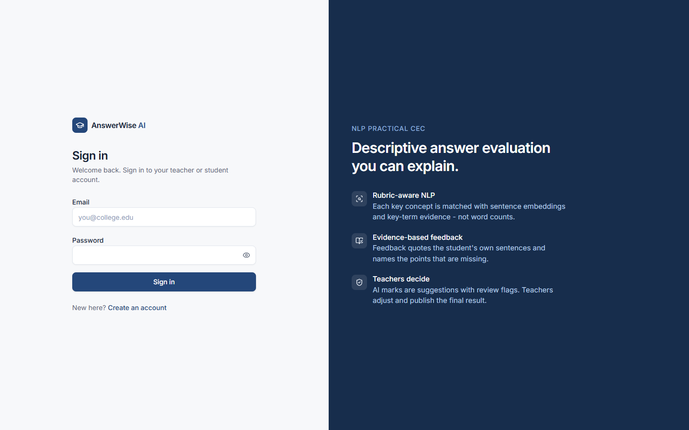 Login | 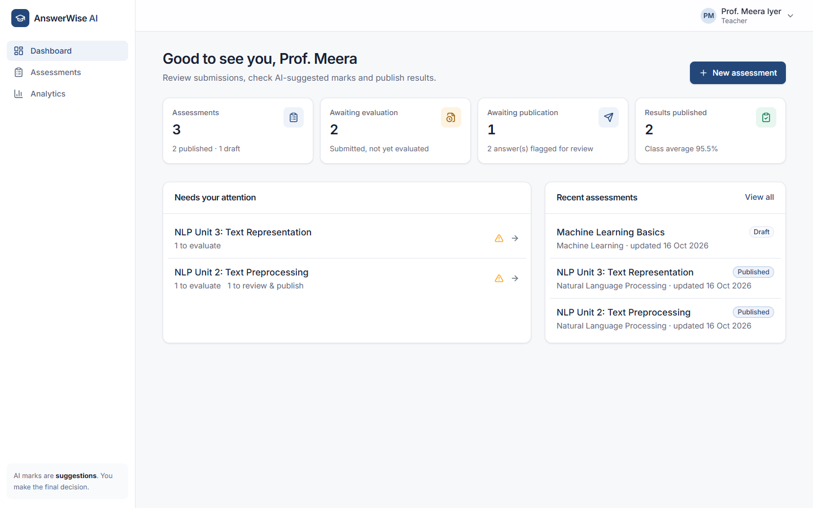 Teacher dashboard |
| 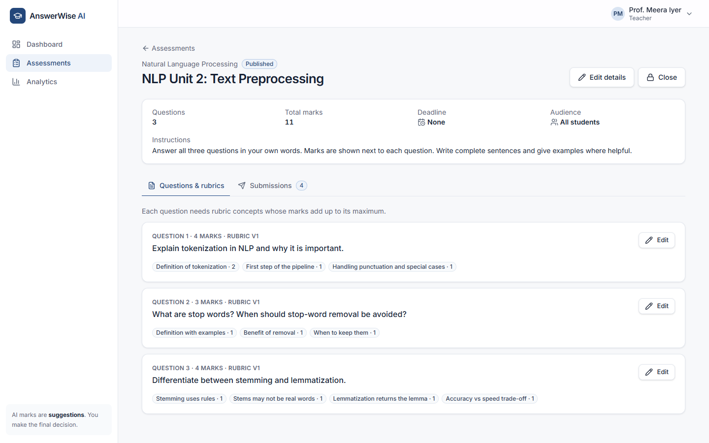 Assessment with rubric summary | 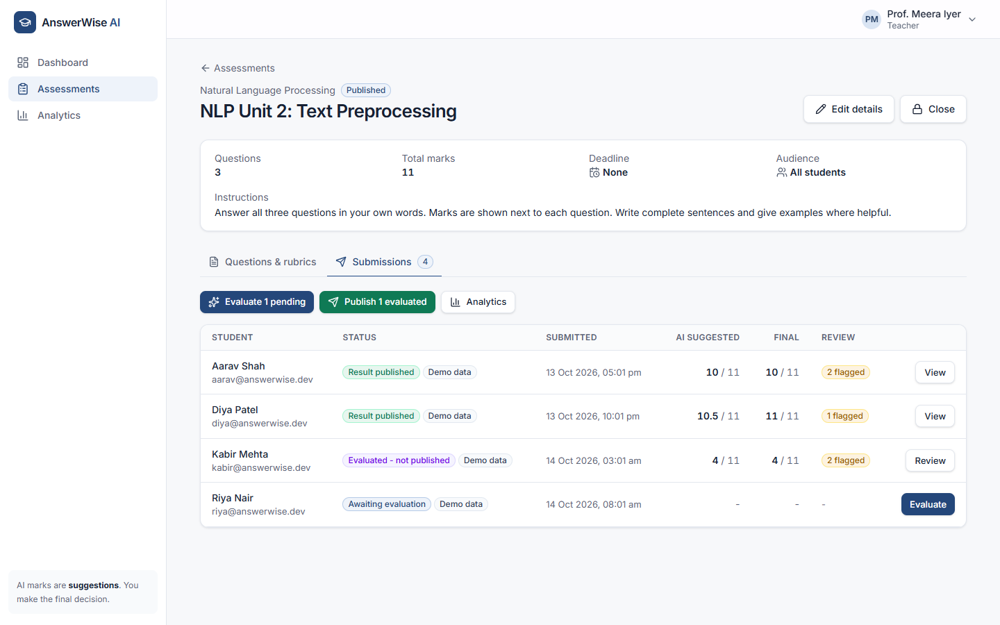 Submission management |
| 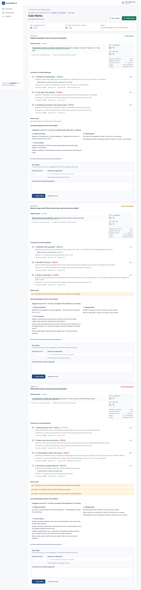 Answer evaluation & review (evidence, concepts, flags, adjustment) | 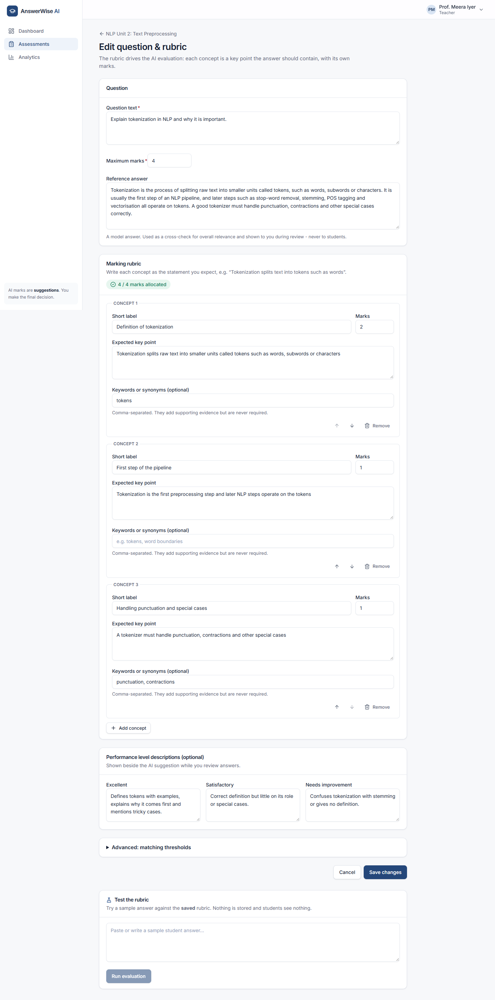 Question & rubric editor |
| 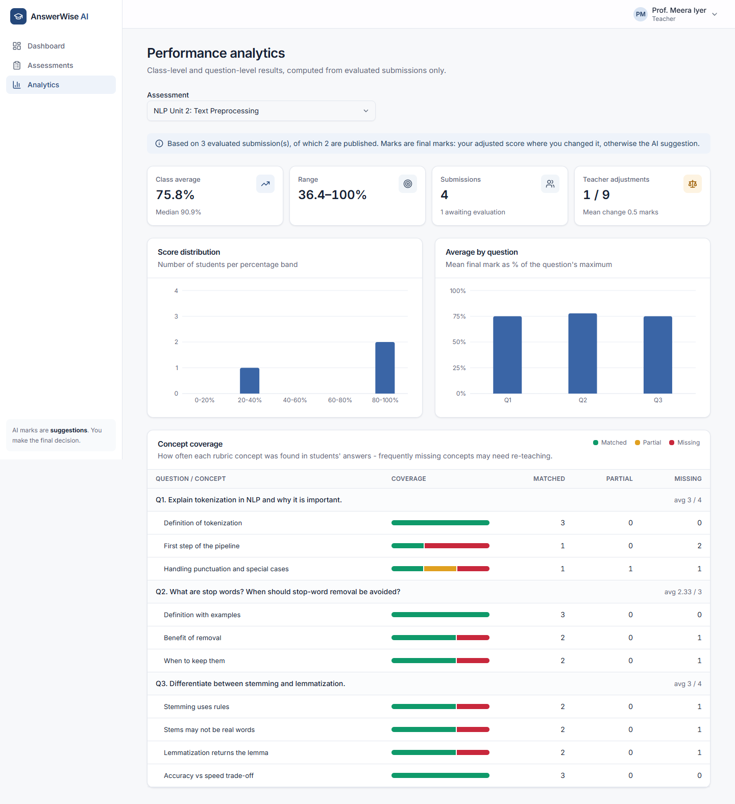 Performance analytics | 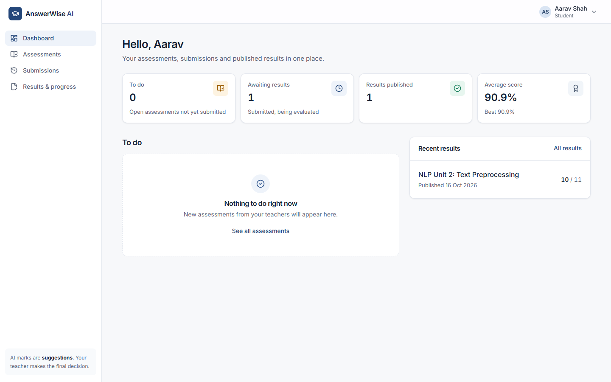 Student dashboard |
| 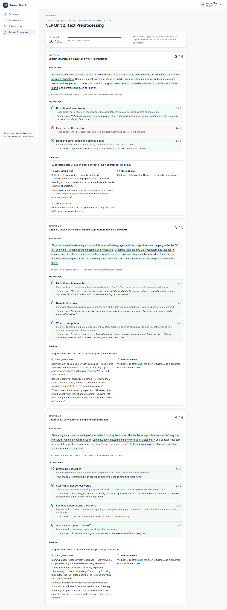 Published result with feedback | 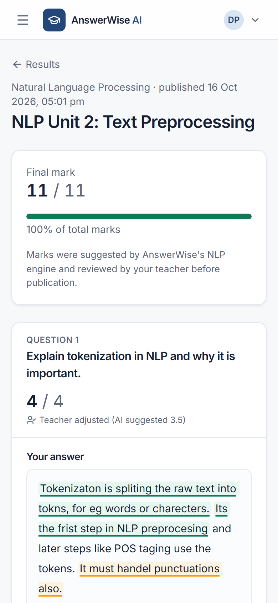 Mobile layout |

Regenerate them with `python docs/capture_screenshots.py` while both servers are running.

## 19. References

1. Reimers, N. & Gurevych, I. (2019). *Sentence-BERT: Sentence Embeddings using Siamese BERT-Networks.* EMNLP.
2. Wang, W. et al. (2020). *MiniLM: Deep Self-Attention Distillation for Task-Agnostic Compression of Pre-Trained Transformers.* NeurIPS. Model card: `sentence-transformers/all-MiniLM-L6-v2`.
3. Mu, J. & Viswanath, P. (2018). *All-but-the-Top: Simple and Effective Postprocessing for Word Representations.* ICLR. (Removing dominant common directions from embeddings; the idea behind topic debiasing.)
4. Mohler, M., Bunescu, R. & Mihalcea, R. (2011). *Learning to Grade Short Answer Questions using Semantic Similarity Measures and Dependency Graph Alignments.* ACL.
5. Burrows, S., Gurevych, I. & Stein, B. (2015). *The Eras and Trends of Automatic Short Answer Grading.* IJAIED 25.
6. Porter, M. F. (1980). *An algorithm for suffix stripping.* Program 14(3).
7. Cohen, J. (1968). *Weighted kappa.* Psychological Bulletin 70(4).
8. Zhang, T., Kishore, V., Wu, F., Weinberger, K. & Artzi, Y. (2020). *BERTScore: Evaluating Text Generation with BERT.* ICLR. (Token-level recall tested in v3.)
9. Documentation: FastAPI, Pydantic, PyMongo, sentence-transformers, scikit-learn, NLTK, React, Vite, Tailwind CSS, Radix UI, Recharts.

## 20. License

**No license has been selected yet.** Until the team chooses one (for example MIT), all rights are reserved by the authors. Third-party libraries and the MiniLM model are used under their own licenses (the model is Apache-2.0).
# nlp_cec

